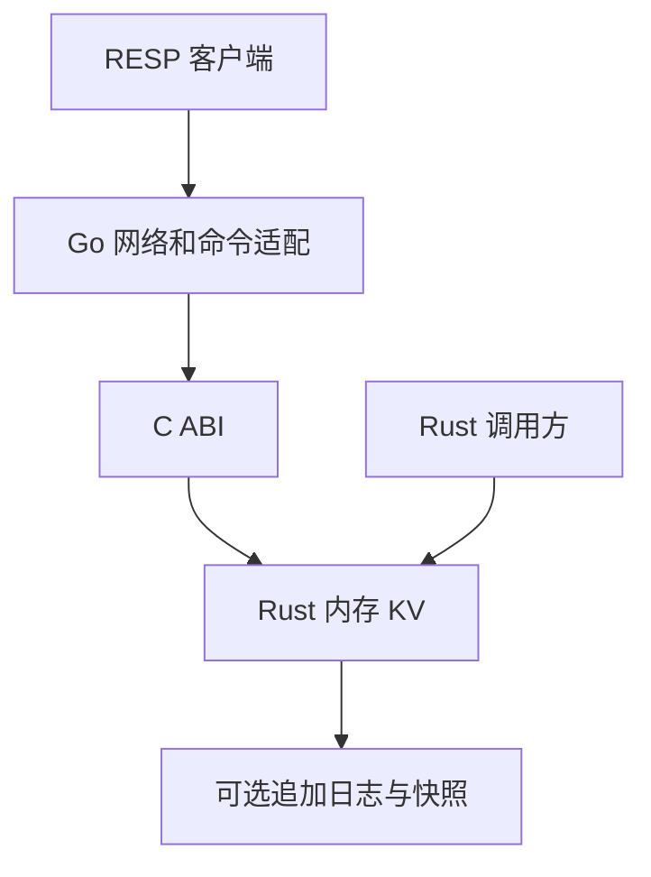

# ADR 0001 · 以 WSL 为主环境的 Rust 内存 KV 内核

状态为已采纳，记录日期为 2026-11-21。

## 背景

项目聚焦小键值、高并发和低尾延迟。拟将 Rust 改为独立的主存 KV 内核，Go 作为 Redis 协议适配层。早期评估以旧 `engine_v2` 为依据。本地代码已经修复 checkpoint 错误静默忽略、完整记录校验失败误作截断尾、批次只恢复前缀、启动时编译动态库和持久化初始化失败回退内存等问题。

当前纯内存模式由 Go 管理数据。持久化模式由 Go 管理缓存、类型和 TTL，Rust 管理 segment 日志及 `BTreeMap<Key, ValueLocation>` 索引。Go 缓存未命中时，Rust 按位置从 segment 文件读值。Rust 的 `SyncPolicy::None` 仍追加日志，只跳过提交时的同步。[现有架构](../kerniva_engine_architecture.md)

11 月 17 日的同步持久化实验中，逐键等待改动令主场景 GET p99 下降 1.08%，SET p99 上升 32.01%。主场景的候选版本两次 8 分钟长测分别出现 882 和 2,331 次失败，长尾原因仍待定位。现有版本及其测量保留为迁移对照。[实验报告](../thesis_second_overnight_report.md)

## 决策

Rust 提供独立的二进制 KV 内核。分片 `HashMap` 存完整键值，使用读写锁和不可变值。Rust 管理 TTL、版本、原子更新和内存预算。纯内存模式可独立使用 Rust 库，启动和读写都无需数据目录。Go 继续负责 TCP、RESP、命令语义和连接，最终通过 C ABI 调用 Rust，首批仅迁移字符串命令。复用现有网络、解析、动态库加载、测试和压测入口。

新后端以整实例选择，按逻辑库隔离；迁移期间两个后端使用独立实例和数据目录。进入新后端的命令从同一份 Rust 状态读取和修改数据。未覆盖命令在实验实例上明确返回暂不支持。现有持久化格式中的 value 包含 Go 的 `DataValue` 序列化内容。后续复用记录、校验、批次封装和恢复测试时，给新日志加格式版本，再单独设计旧数据迁移。

初始内核提供 `get`、`put`、`delete` 和 `stats`。内存预算耗尽时，拒绝会超限的写入并保留旧值。并发读持有旧的不可变值，作用域结束后释放。第一版明确预算的计量口径，同时记录 RSS。引入共享快照或后台日志队列前，补充在途数据与被持有旧值的计费规则。下一阶段增加绝对过期时间、按版本条件更新和跨分片原子批次。条件判断和写入在 Rust 内完成，原子批次一次发布。

同步持久化模式的写入先等待日志达到约定的同步边界，再发布并回复成功。同步失败向调用方返回错误，已提交状态保持可读。未确认的写入按明确的恢复契约处理。将来生成全量快照时保存键值、绝对过期时间和版本，恢复时加载快照再重放后续日志。周期同步单独定义丢失窗口和验收标准。

## WSL 开发与运行

- 以 WSL 2 为日常构建、运行和正式实验环境。工作副本、构建输出、数据库目录与压测文件放在 WSL 的 ext4 上。正式对照将 Kerniva、Redis 和客户端放在同一 WSL，使用 Linux 回环网络。
- 从已发布的 Git 提交建立 WSL 开发副本，并在一份工作树上维护源码。Windows 用于编辑和访问演示。现有 Windows 构建路径仍可用于兼容性回归。
- 日常构建使用 `bash scripts/build.sh`，回归使用 `bash scripts/test.sh -race`。前台运行使用 `./bin/kerniva-server -config ./config.yaml`，CLI 可通过监听端口连接。数据与日志由所选配置定义，实验实例使用自己的回环端口和数据目录。
- 2026-11-21 已在 WSL ext4 解包 11 月 17 日交付源码，重新构建并通过 41 项 Rust 测试和完整 Go race 回归。安装的 Redis 8.0.5 提供客户端，已通过独立端口和数据目录检验 std 同步模式的 PING、SET、GET，停止服务并重启后仍能读到该测试值。使用 Go 1.26.8 和 Rust 1.95.0。Windows 若从关闭虚拟机监控程序的配置启动，需要先启用并重启才能使用 WSL2。

## 备选路线及取舍

| 路线 | 适用场景和取舍 |
| --- | --- |
| 延续 Go 缓存和 Rust 磁盘内核 | 现有命令与持久化路径可直接运行，适合作为演示和对照。继续做性能改造仍需协调 Go 缓存、Rust 索引和冷读。 |
| Rust 主存内核加 Go 适配层 | 让值、TTL 和版本集中管理，Rust 库可以独立使用。需要逐步迁移数据语义，重新测量 ABI 复制和内存开销。 |
| 同期重写网络层并迁移所有命令 | 可减少语言边界，但会同时改变网络、执行和存储，延后首个可测结果，也使收益归因更困难。 |

主存方案给 Rust 原生读取一条无文件 I/O 的路径。数据集需要完整驻留内存，恢复成本取决于快照和日志规模。端到端效果同时受跨语言调用、复制和网络影响，将分别测量。

## 实施顺序与验收

| 阶段 | 工作与完成条件 |
| --- | --- |
| 1. Rust 内存基线 | 先定二进制字符串契约，实现可配置分片、GET/PUT/DELETE、统计和拒绝超预算写入。用 Rust 独立示例读写，验证空值、覆盖、并发读写和预算返还。用文件 I/O 检查确认纯内存路径不创建或访问引擎数据文件，保存原生性能基线。 |
| 2. 原子语义 | 实现 TTL、CAS、NX/XX 所需的条件写和跨分片原子批次。验证过期清理与并发更新、条件失败、预算拒绝以及批次可见性。初版允许使用保守的批次协调锁。 |
| 3. Go 字符串联调 | 通过现有 RESP 入口接通 GET、SET、DEL、EXISTS、EXPIRE、TTL、INCR。按需要接通 MGET/MSET 与 RENAME。测 Rust 原生、Go 经 ABI 和完整 TCP 三层，核对语义、错误返回、分配与调用成本。 |
| 4. 可选同步持久化 | 复用日志编码与恢复测试，补齐数据版本和重启重放。验收进程终止、写入或同步失败、完整记录损坏、不完整尾记录、批次原子恢复，并统计同步和维护等待。 |
| 5. 低尾延迟验证 | 使用长测、热点、多轮对照和消融评估提交与维护方式。按观测结果选取一项机制，例如有等待上限的合并同步或有时间预算的分步维护。验证写入确认、读取延迟、失败率和内存代价。 |

首个里程碑为阶段 1 和 2 通过，阶段 3 的完整 TCP 基线用来判断内核收益能否传到用户请求。复杂类型迁移、完整 Redis 兼容、独立发布和分布式验证排在单机主线之后。现有版本的 WATCH 元数据增长与 EXISTS/TYPE 读取错误返回也需要继续纳入兼容性回归。

## 性能判断

第一轮以 100,000 个 key、32B value、并发 1/4/16/64 为起点，包含读多、写多与热点负载。测吞吐、GET/SET p99 和 p99.9、全部请求中的失败率、RSS 与每键内存。初版先用普通分片 HashMap 建立基线，之后单独评价每项优化。纯内存对照使用双方关闭持久化的配置，强同步对照要求成功回复具有相当的落盘语义。记录源码、编译产物、版本、负载种子和重复轮次。

毕设性能问题定为**同步持久化时，能否降低小键值混合访问的长尾，同时维持写入确认语义和长时间运行稳定性**。先采集客户端排队、Rust 写锁等待、同步耗时和维护起止时间，再选优化点。报告同时给出长测失败率和成功请求延迟。Rust 主存架构为实验提供基础，性能贡献由对应机制的对照和复测确定。

2026-11-24 选择同步期间允许读上一版已提交值作为首个实验机制。同步开始前做好批次准备，使用 WAL 互斥锁维护写入顺序。同步完成后重新锁住涉及的分片并一次发布。两种锁策略共用一份同步与发布路径，可用同一产物进行对照。可选同步服务和原始实验的结果见 [WSL 实验记录](../rust_memory_wsl_report.md)。

高写入压力下，加入可选的同步组提交。Go 每库只取已经排队的请求，组大小上限为 8。Rust 在同一个 WAL 写锁内检查每条 SET 的准入条件，使组内每步保持原有内存预算。只有明确表示整组尚未修改的结果允许逐条执行。其他错误返回给整组，所有成功请求仍在同一次同步后确认。配置默认逐条同步，便于对照并保持低负载的直接调用路径。
