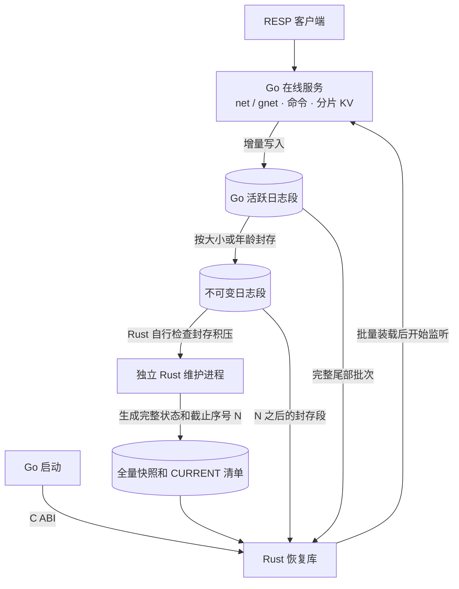

# ADR 0002 · Go 写入日志与 Rust 自主快照

状态为毕设开发方案。记录日期为 2026-11-24。保留现有 Go 协议、命令和分片内存层。由 Go 写入线上增量日志，由独立 Rust 进程生成全量快照、整理并回收封存日志。启动恢复通过 C ABI 复用 Rust 库。业务请求从接收到响应都在 Go 内执行。

Redis 的 AOF 记录增量写入，RDB 保存某一时点的全量状态，两种机制可以组合。Kerniva 采用自己的文件格式和提交序号，按已封存文件在两个进程之间交接。 [Redis 持久化文档](https://redis.io/docs/latest/management/persistence/)

## 架构与所有权

| 组件 | 职责和独占写入范围 |
| --- | --- |
| Go 服务 | TCP、RESP、命令、16 个逻辑库、分片键值表、TTL。独占活跃日志的追加和日志轮转。命中内存的业务读写在 Go 完成。 |
| Rust 维护进程 | 默认每秒检查一次封存段，待整理日志达到 16 MiB 或最老段达到 300 秒时自行开始任务。按截止序号重建全量状态，发布快照并回收覆盖日志。每个数据目录只运行一个维护实例。 |
| Rust 恢复库 | Go 开始监听前通过 C ABI 调用，加载最新发布的快照并回放后续完整批次，逐行将恢复结果交给 Go。 |

Go 与维护进程以数据目录协议协作。Go 按大小或年龄轮转非空段，低写入量时也能封存。维护进程暂时退出时，Go 可继续追加日志，封存积压和磁盘用量增加。全量快照期间，Rust 会额外持有一个逻辑库的重建状态，并占用磁盘读写带宽。

## 日志与快照的分界

1. 每个逻辑库在 Go 的持久化提交顺序中分配连续的提交序号。一条或多条需要原子恢复的修改构成一个带校验的完整批次。记录修改后的值、删除标记、绝对过期时间及需要持久化的重置标记。
2. Go 完成写入、同步并可靠发布封存段后，该段成为不可变输入。段带有首尾序号。Rust 从已发布快照截止序号 `S` 开始，只处理 `S+1` 到 `N` 的连续封存段。若还没有快照，从第一段开始。每个库有自己的截止序号。
3. Rust 以旧快照为起点，按序应用覆盖、删除和重置，得到截止 `N` 的完整状态。保留的值携带 Go 序列化后的绝对过期时间，Go 恢复和读写时判断是否过期。Rust 把快照和元数据写入新文件，记录版本、截止序号、完整性校验。
4. Go 在 Rust 整理时继续处理序号大于 `N` 的更新。热 GET 读取 Go 内存里已经发布的值，Rust 快照发布和回收均不改变 Go 内存。同步模式下 Go 在日志同步成功后发布修改并确认写入。

例如 Rust 整理到序号 100 时看到 `k=1`，Go 随后以序号 101 写入 `k=2`。快照中仍是 `k=1`，运行中的 GET 读到 `k=2`。重启时装载快照，再回放 101 及后续修改，最终同样读到 `k=2`。删除标记和绝对过期时间按同一规则恢复。

## 文件发布、回收和恢复

- Rust 先写并同步快照，再同步并原子发布 `CURRENT` 清单。按平台保证文件和目录元数据的持久化。清单生效后才回收截止序号及以前的封存日志，始终保留大于截止序号的记录。遇到跨越截止序号的段保留整段，回放时按序号跳过已覆盖记录。
- Go 启动恢复和 Rust 发布回收共用文件锁。启动恢复按同一代清单读取快照和后续日志，Rust 提交阶段持排他锁后发布和回收。生成快照的长操作在锁外进行。Go 的日常处理与快照锁互相独立。
- 维护进程中途结束时，临时文件由下次运行处理。失败时依据已可靠发布的清单选择快照；回收已经开始时使用对应的新清单。发生序号缺口、段中间损坏或快照校验失败时报告恢复错误。不完整的最后一批活跃日志按尾部截断处理。恢复后下一次提交从现有最大序号继续。
- 正式数据目录采用带版本号的新格式，与旧后端分别运行。跨语言测试用同一批记录向量核对长度、序号、操作类型、校验和与过期语义。

`data/go-log-v1/db_N` 下的 `active.log` 与 `log-<first>-<last>.seg` 使用 `KGLLOG01` 头。每个帧含小端长度、IEEE CRC32、提交序号、操作数及操作列表。键和值按字节存放，一帧负载最多 256 MiB。`snapshot-<cutoff>.bin` 用 `KGLSNP01` 和校验值记录截止序号、键数量及完整键值。`CURRENT` 内容是十进制截止序号。Go 写者锁、Rust 维护实例锁和恢复锁各自保护不同职责。

`sync` 确认已同步写入。进程若在落盘成功后、发送响应前结束，恢复可能包含客户端尚未收到确认的完整批次。`none` 允许掉电丢失仍在系统缓冲区的数据，轮转时也会同步封存段。

## 毕设范围和验收

| 事项 | 验收口径 |
| --- | --- |
| 任务书中的 Go 功能 | 复用 net/gnet、RESP、至少 31 条命令、分片并发、TTL、16 个逻辑库、YAML 和环境变量。两种网络入口跑同一组命令测试。 |
| Rust 与 C ABI | Rust 真实读封存日志、生成全量快照、负责回收和恢复。Go 在线直接写日志是相对于任务书的职责调整，ABI 的调用发生在启动恢复。 |
| 冷启动 | 新后端先交付 `load_all`，数据集常驻内存。将 `lazy_load` 列为后续验收项，设计时需明确 Go 的按位置冷读与 Rust 回收之间的文件引用保护。 |
| 正确性 | 暂停 Rust 整理，让 Go 覆盖、删除、设置过期和跨段继续写。恢复后逐键核对最新状态。在写快照、清单切换和回收各阶段强制结束，检查已确认同步写入的恢复。 |
| 性能 | 以 10 万个小键值、64 连接、同一落盘配置比较 Rust 整理前、整理中与整理后。记录 GET/SET p99.9、吞吐、失败率、CPU、磁盘与日志大小。对业务请求验证 C ABI 调用次数为零。 |
| 工程化 | 在 WSL ext4 跑正式对照，Windows 与 Ubuntu 22.04 保留构建、Go race、Cargo 测试和 ABI 启动记录。 |

实施顺序为 Go 写入与封存、Rust 恢复、Rust 自主快照及回收、崩溃测试、维护时的性能测试。现有后端和已完成的 FFI 对照可作为迁移基线。 [既有系统架构](../kerniva_engine_architecture.md) · [原存储格式和接口](../kerniva_engine_design.md)
