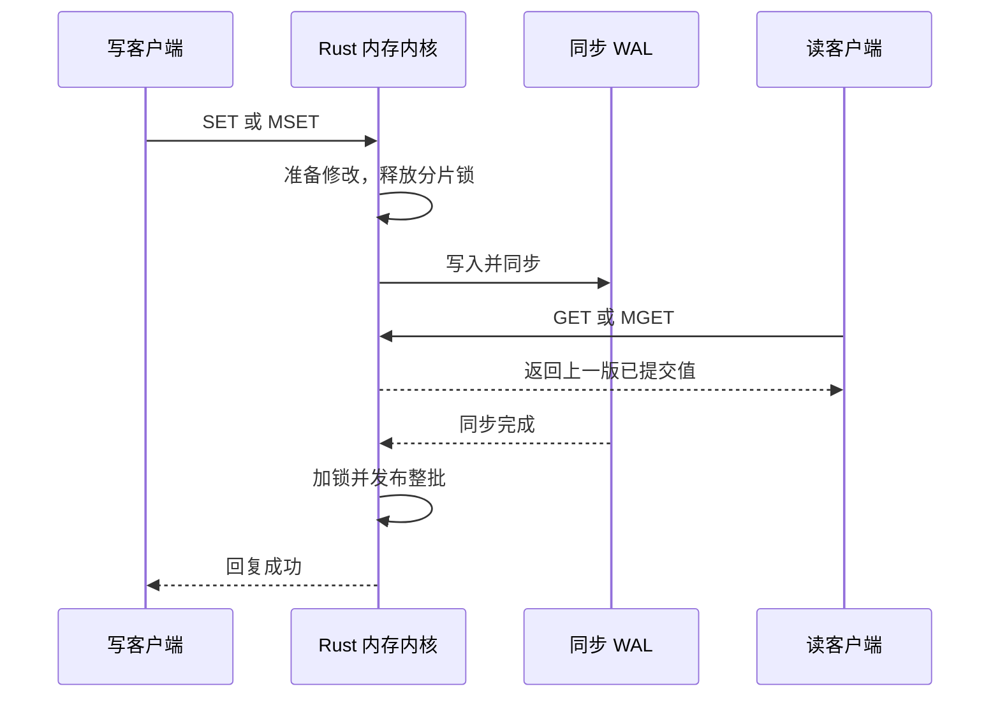

# Rust 主存内核 WSL 实验记录

记录日期为 2026-11-24。毕业设计主线是小键值、高并发和低尾延迟。工作区、数据目录和压测产物使用 WSL 2 的 ext4，服务端与客户端使用同一 WSL 的回环地址。实验环境为 Linux 6.18.58.1 WSL 2、32 个可见逻辑 CPU、Go 1.26.8、Rust 1.95.0 和 Redis 8.0.5。

## 原生内核基线

源码为 `ce94ef7`。测试数据为 100,000 个 8B 键、32B 值。先筛选 1、4、16、64 个线程和 1、16、64 个分片，再对 95% 读的重点负载重复五轮。59 个短窗口一共完成 128,000,000 次测量操作。各窗口预填充后检查了全部键，测量和校验均无失败。常驻键值 payload 为 4,000,000 B。

| 线程 | 分片 | 吞吐中位数，Mops/s | GET p99 / p99.9，µs | PUT p99 / p99.9，µs | 峰值 RSS 中位数，MiB |
| ---: | ---: | ---: | ---: | ---: | ---: |
| 16 | 1 | 6.500 | 57.193 / 235.986 | 122.646 / 224.072 | 30.47 |
| 16 | 16 | 31.602 | 0.601 / 76.692 | 1.916 / 134.361 | 21.26 |
| 64 | 1 | 4.431 | 443.014 / 1,312.376 | 386.291 / 711.634 | 30.54 |
| 64 | 16 | 27.504 | 1.492 / 414.163 | 78.600 / 401.891 | 28.73 |

每格延迟是对应分位数的五轮中位数。16 线程单轮 GET 样本约 950,000，PUT 约 50,000。RSS 同时包含 Rust 内核、分配器、程序及压测工具的键目录与样本。原生延迟从调用进入到返回值释放，吞吐计入键选择和计数。压测线程会在请求完成后继续操作，属于闭环测量。

单热点且 95% 读时，16 线程在 1、16、64 分片分别达到 7.846、7.772、6.230 Mops/s，GET p99 分别为 44.030、42.357、58.930 µs。这三个数各来自一个短窗口。同一个键会始终进入同一个分片，分片收益取决于键分布。纯内存模式在空目录中的系统调用跟踪只看到进程启动相关文件访问，工件中保留了跟踪全文。

单热点长测使用相同的 Phase 1 二进制、16 分片和 16 线程。571.54 秒内完成 4,376,658,928 次操作，约 7.66 Mops/s，零失败，运行后再次核对全部 100,000 个键。每 8,192 次操作抽取一次延迟，GET 共 507,658 个样本，p99 和 p99.9 分别为 60.69 µs 和 204.25 µs。PUT 共 26,602 个样本，p99 和 p99.9 分别为 121.79 µs 和 212.66 µs。进程采样峰值 RSS 约 21.0 MiB，包含压测工具及延迟样本。这组长测用来验证单热点下一次完整运行的稳定性。

## 原子语义与 RESP 联调

`162e9a7` 在 Rust 中加入绝对过期时间、条件写、版本和跨分片批次。15 项语义测试覆盖过期边界、CAS、预算、批次全量拒绝和并发可见性。按版本更新由 Rust 在锁内检查，原生读引用可以安全保有旧值。

`3effa28` 接入独立 C ABI 和 Go 实验后端。Go 将 GET 的目的缓冲区交给 Rust，后续编码 RESP。MGET 一次进入 ABI 并读取一致视图，MSET 一次进入 ABI 并提交原子批次。默认部署继续使用现有 Go 后端。`7b954f3` 验证 std 和 gnet 两条入口上的二进制、空值、隔离与批次行为。

后续补齐了 RESP 的条件 SET、TTL、计数和多键删除。在同一 WSL 上通过实际 Go 包装器测试单请求的 32B 访问，用五个 1 秒窗口测得 GET 中位数 183.5 ns/op、覆盖写 195.0 ns/op。Go 每次 GET 仍有两个分配（56 B），覆盖写每次一次（48 B）。这里包含 Go 生命周期锁、调用边界和 Rust 查表或更新，且读使用复用缓冲区。结果未计入 TCP 与 RESP 编码。

## TCP 定速对照

在同一个 WSL 上分别运行旧内存后端、Rust 16 分片内存后端和 Redis。两个 Kerniva 后端使用同一个 Go 服务端、同一个 Rust 动态库和 gnet，Redis 使用自己的 TCP 实现。三者均关闭持久化。每轮使用相同负载种子，100,000 键、32B 值、64 个连接、95% 读。每档做四轮，每窗预热 5 秒、测量 20 秒。到达速率按计划分配，延迟从计划发起算到完整应答，包含客户端排队。

| 请求/秒 | 后端 | GET p99 / p99.9，ms | SET p99 / p99.9，ms | 峰值 RSS 中位数，MiB |
| ---: | --- | ---: | ---: | ---: |
| 15,000 | Go 内存 | 1.534 / 1.724 | 1.530 / 1.716 | 70.26 |
| 15,000 | Rust 内存 | 1.524 / 1.708 | 1.534 / 1.698 | 45.88 |
| 15,000 | Redis | 1.522 / 1.712 | 1.511 / 1.720 | 29.52 |
| 45,000 | Go 内存 | 0.498 / 2.458 | 0.438 / 2.183 | 73.17 |
| 45,000 | Rust 内存 | 0.563 / 1.855 | 0.581 / 1.794 | 46.82 |
| 45,000 | Redis | 1.702 / 2.363 | 1.702 / 2.355 | 29.54 |
| 90,000 | Go 内存 | 4.186 / 7.545 | 4.137 / 7.487 | 75.06 |
| 90,000 | Rust 内存 | 4.116 / 8.733 | 4.116 / 8.888 | 45.81 |
| 90,000 | Redis | 1.473 / 3.961 | 1.470 / 3.908 | 29.50 |

36 个窗口发出 36,000,000 个请求，全部返回成功。35 个窗口通过负载门槛。9 万请求/秒的 Rust 第一轮测量窗口内只完成约 87,184 请求/秒，GET p99 和 GET 客户端队列 p99 同为 1,581 ms。该轮的请求在窗口结束后成功排空。队列指标解释了该轮的大部分尾延迟数值，触发排队的原因仍待复测。

各档 Rust 后端的服务进程峰值 RSS 中位数比旧 Go 后端低约 35%–39%，Redis 的峰值 RSS 约 29.5 MiB。4.5 万请求/秒时，Rust 的 GET p99.9 在四个配对轮次都低于旧 Go 后端。9 万请求/秒时 Redis 的延迟更低，Rust 路径出现一次明显排队。结果支持继续验证内存占用和持久化读等待，持续吞吐和尾延迟优势仍待长测。RSS 包括整个服务进程，三种引擎的预算计量口径各自不同。

分析工具保留每个短窗和同轮配对。四轮无法完全平衡三种后端的出场顺序，报告保留全部窗口。逐回复校验能发现错误响应、错键或损坏。由于 SET 重复写入与键对应的固定值，最新提交的可见性由并发功能测试单独验证。

## 同步持久化正确性基线

独立的 `DurableMemoryEngine` 保存驻内存的完整键、值、版本和绝对过期时间。每批修改由一帧 WAL 记录并同步。当前基线在受影响分片保持写锁时同步日志，成功后原子发布。纯内存服务与旧 segment 数据仍各有独立路径。

9 项新测试涵盖写入确认后的进程终止、跨分片批次恢复、版本和过期时间、短写和同步失败回滚、回滚失败后的写保护、日志尾截断及完整帧损坏。完整 WSL 回归通过 76 项 Rust 测试和 Go race。原生验证的 50,000 个混合请求中，2,582 个写入分别完成一次同步，新增 WAL 278,856 B。测量窗口内全部请求成功。

当前 WAL 持续追加，恢复时顺序重放。需要另做 checkpoint 和裁剪时，应保留独立的维护时延和崩溃窗口验证。内存限额按最终恢复的常驻键值计量，重放工作集可能更大。

## 同步期间的读等待

`2ef889f` 在同一个 Rust 内存内核上实现两种锁策略。持锁模式在受影响的分片持有写锁直到 WAL 同步完成。已提交读模式先准备整批修改，再释放分片锁完成同样的同步，随后取回受影响分片的写锁并一次发布整批。全局写入顺序由 WAL 锁维护。同步期间读请求可读到上一版已提交值。注入测试暂停同步，验证读请求可以完成、MGET 始终读取完整批次、待提交写入不能提前可见，且第二个写入仍须等待。

原生对照固定 16 分片、100,000 键、32B 值、95% 读、每窗 300,000 次操作。16 与 64 线程分别运行均匀访问和单键热点。三轮配对交换两种模式出场顺序，全部 24 窗共完成 7,200,000 次操作。任意一组同轮配对的读写次数、每次写入一次同步及新增 WAL 字节数均相同。每个操作都测量延迟。

| 线程 | 键分布 | GET p99，µs 持锁 → 已提交读 | GET p99.9，µs 持锁 → 已提交读 | 吞吐配对中位变化 |
| ---: | --- | ---: | ---: | ---: |
| 16 | 均匀 | 610.1 → 0.9 | 871.5 → 4.8 | +0.3% |
| 16 | 单热点 | 549.0 → 0.35 | 1,175.6 → 1.8 | -0.8% |
| 64 | 均匀 | 600.2 → 0.8 | 882.1 → 4.7 | -0.6% |
| 64 | 单热点 | 4.3 → 0.36 | 1,005.5 → 1.7 | +1.7% |

每档 GET p99.9 在三轮均降低。均匀访问的 PUT p99 在 16 线程的三轮中位数由 79.7 ms 降至 56.7 ms，64 线程由 358.8 ms 降至 246.5 ms。64 线程单热点有一轮 PUT p99 上升。第三轮每窗耗时约 40–42 秒，前两轮约 9–11 秒，同步环境有明显波动。吞吐受同步速率限制；这些数据说明原生调用的读等待变化。实际服务请求还会受到 TCP、Go 调度及连接队列影响。

`456a6bc` 将同步后端作为可选模式接入 Go。两种策略都完成正常重启与 RESP 双库隔离测试。WSL 上用独立服务器验证目录锁，并在已确认 65 次写入后强制终止进程。std 两种策略及 gnet 已提交读均能重新打开并读回最终批次。此处验证进程崩溃恢复。WAL 同步受 WSL 文件系统和宿主存储保障约束。

## 同步 RESP 对照

使用相同的 Go 服务端、Rust 动态库和 std 监听器，仅通过配置切换锁策略。100,000 键、32B 值、64 连接、95% GET，每档测四轮，每窗 5 秒预热和 30 秒测量。2,000 和 5,000 请求/秒的校准通过。10,000 请求/秒的两轮虽最终均返回成功，窗内只达到约 82%–86% 目标速率，GET p99 超过 2 秒。此时累计 WAL 同步耗时占测量与排空时间的约 93%–99%。正式对照选用 5,000 请求/秒，16 窗均达标，2,400,000 个请求均成功。每窗已确认 SET 数与 WAL 提交数和同步次数相符。

| 键分布 | GET p99 / p99.9，ms 持锁 → 已提交读 | SET p99 / p99.9，ms 持锁 → 已提交读 |
| --- | --- | --- |
| 单热点 | 2.081 / 2.736 → 1.540 / 1.663 | 3.043 / 5.030 → 3.084 / 5.317 |
| 均匀 | 1.575 / 1.999 → 1.546 / 1.667 | 3.224 / 4.776 → 3.293 / 4.694 |

单热点的 GET p99、p99.9 同轮配对变化中位数分别降低约 26% 和 39%。均匀访问的 GET p99.9 配对变化中位数降低约 17%。两档的 GET p99、p99.9 均为四轮全部降低。端到端观察时间从计划发出到收到回复，包含客户端排队。每窗约有 7,500 个 SET，p99.9 对应最高约 7–8 个写入样本，写尾小幅变化需要结合各轮分布。正式对照中单次 WAL 同步均值约 0.68–0.94 ms，低于此前 10,000 请求/秒校准的约 2.31–2.37 ms，反映实验期间存储时延波动。

### 同步 Redis 和旧后端

同样的单热点负载和 5,000 请求/秒，轮换旧 Kerniva、开启已提交读的 Rust 同步后端与 Redis。Redis 使用 AOF always，关闭 RDB。旧 Kerniva 使用 strong/sync，保留默认 segment 和 checkpoint 配置。三轮共 9 窗、1,350,000 个请求全部成功，窗内速率均达标。

| 后端 | GET p99 / p99.9，ms | SET p99 / p99.9，ms | 峰值 RSS 中位数，MiB |
| --- | ---: | ---: | ---: |
| 旧 Kerniva | 2.261 / 4.424 | 3.056 / 7.487 | 78.47 |
| Rust 同步，已提交读 | 1.552 / 1.675 | 2.998 / 4.186 | 64.17 |
| Redis AOF always | 7.815 / 40.239 | 8.782 / 44.433 | 29.60 |

三轮中，新后端的读尾都低于两个对照。Redis 的 GET p99.9 三轮范围约 3.65–252.71 ms，波动明显，所有窗口均保留。Redis 的 RSS 和进程 CPU 更低。Redis 可将多个命令合并同步，旧 Kerniva 有 checkpoint，Rust 新 WAL 暂时仅追加。此组对照覆盖整体实现差异，锁策略的净影响以同一二进制的对照为准。[Redis 持久化文档](https://redis.io/docs/latest/management/persistence/)

### 8 分钟稳定性与重放

同一单热点负载、5,000 请求/秒，每种策略跑一窗 480 秒。两窗共 4,800,000 个请求，均达标且零失败。每窗 120,280 个 SET 各完成一次同步。重启后两份 WAL 各校验全部 100,000 个键的二进制值，保留文件均为 23,042,150 B，从进程启动到监听响应约 0.13 秒。

| 策略 | GET p99 / p99.9，ms | SET p99 / p99.9，ms | 单次同步均值，ms | 峰值 RSS，MiB |
| --- | ---: | ---: | ---: | ---: |
| 持锁 | 4.047 / 704.643 | 11.174 / 780.141 | 0.897 | 70.59 |
| 已提交读 | 1.536 / 21.365 | 23.462 / 122.159 | 2.476 | 67.86 |

持锁窗的主要排队尖峰出现在最后一分钟，GET 客户端队列 p99.9 约 694 ms。已提交读窗也有排队尖峰，两窗中的同步耗时走势和系统资源状态存在波动。长测验证了本次运行的完成率、确认写入和最终数据。策略的收益大小应以轮换出场顺序的多轮对照估计。

## Go 与 Rust 的调用成本

`dfa5487` 复用普通 GET 和 SET 的 Go ABI 参数帧，并在原生调用期间保留输入和输出缓冲区的 Go 引用。Rust 动态库及其 ABI 保持一致。用优化前后两个 Go 测试二进制，交换出场顺序做六轮微基准。每轮包含单线程与 `GOMAXPROCS=16` 两档，相同的 100,000 键、32B 值。下表耗时是六轮各自的中位数，百分比是同轮变化的中位数。

| 用例 | 优化前 → 优化后，ns/op | 配对变化 | 稳态 Go 分配 |
| --- | ---: | ---: | --- |
| 串行 GET，1 个 P | 178.95 → 153.50 | −11.72% | 56 B 和 2 次 → 0 B 和 0 次 |
| 并行 GET，16 个 P | 108.55 → 76.68 | −30.95% | 56 B 和 2 次 → 0 B 和 0 次 |
| 串行 SET 覆盖，1 个 P | 190.80 → 187.80 | −1.91% | 48 B 和 1 次 → 0 B 和 0 次 |

并行 GET 六轮均改善，串行 SET 三轮改善。并行的 ns/op 由总墙钟时间除以操作数，衡量汇总吞吐。分配统计来自 Go 稳态基准，池首次获取及被 GC 清理后可以重新分配，Rust 侧的值分配也不在此统计内。检查指针的 Go race 测试和完整 WSL 回归通过。已有演示页通过本地 HTML 加载、INFO 后端识别和 SET/GET 往返检查。

## 可选的同步组提交

锁策略保持为已提交读，比较逐条同步和最多合并 8 条的写入。Go 只合并已经排队的小键值普通 SET。Rust 检查已存在且无 TTL、替换值长度相等，再把一组修改写进同一 WAL 帧。同一键重复覆盖时按组内顺序分配版本，恢复为最后一个值。所有成功回复等这次同步完成。std 与 gnet 两个实例分别在确认 96 个 SET 后强制终止，重启都逐键读回完整更新。std 将 94 条已确认请求合入 12 组，gnet 将 94 条合入 13 组。

用同一套产物及 64 个 std 连接，按单热点、95% GET、100,000 键和 32B 值做四轮配对。每窗 30 秒。计划发出 14,400,000 个请求，其中开启组提交的 7,200,000 个请求全部成功。使用确认后的 INFO 核对成功 SET 和物理同步次数。

| 目标请求/秒 | 逐条同步达标 | 最多合并 8 条达标 | 合并模式每个确认 SET 的同步次数中位数 |
| ---: | ---: | ---: | ---: |
| 5,000 | 4/4 | 4/4 | 0.940 |
| 20,000 | 3/4 | 4/4 | 0.788 |
| 35,000 | 0/4 | 4/4 | 0.439 |

5,000 请求/秒时读尾总体接近，合并模式有一窗 GET p99.9 为 213 ms，四轮结果不支持在此负载默认开启。20,000 请求/秒两边都达标的三轮中，GET 和 SET p99.9 的同轮比值中位数均约为 0.30。逐条同步的一个达标窗口也有约 3.37 秒的 GET p99.9。35,000 请求/秒时，逐条同步四窗实际在测量期内完成约 7,360–25,325 请求/秒，客户端积压队列丢弃 1,791,746 个计划请求。合并模式四窗均约 34,999 请求/秒，GET p99.9 的 2.08–1,098.91 ms 仍有明显波动。该档数据反映本机短窗承载能力，读尾延迟的主对照仍采用前面的同负载锁策略实验。

## 证据位置

执行目录外的 `~/kerniva-memory-runs/20261124` 保存了每阶段的源码版本、命令、构建日志和原始结果。`phase1/native` 保存每个原生窗口的 JSON 和 RSS 时间记录。`phase3/artifacts` 与 `phase3/artifacts.sha256` 标识 TCP 实验使用的服务端、客户端和 Rust 动态库。TCP 工具保存每轮结果、配置、逐秒计数、延迟直方图及进程采样。

`phase1/stability` 保存单热点长测的命令、汇总、采样和核验结果。

TCP 校准和重复对照的原始记录分别在 `phase3/calibration` 和 `phase3/tcp-formal`。使用 `scripts/thesis-analyze.py` 生成的配对表位于 `phase3/tcp-formal/analysis`，负载及身份校验结果在 `phase3/tcp-verified.txt`。

`phase5/measurements` 保留同步策略对照原始窗口，`phase5/independent-review` 保留完整性检查、试验级 CSV 和配对分析。同步服务的构建、回归和目录互斥与崩溃恢复记录位于 `phase6`。同步服务复跑入口为 `phase6/run-formal.sh`，两策略和 Redis 的结果分别位于 `phase6/tcp-ab`、`phase6/tcp-redis`。完整性核验见 `phase6/independent-review/all`。长测和保留 WAL 位于 `phase6/tcp-stability`，分段统计位于 `phase6/independent-review/stability`，逐键重放核验保留在 `phase6/stability-replay.jsonl`。

`phase7-abi` 保留二进制哈希及源码版本、六轮 ABI 原始数据、汇总 CSV、逃逸分析和测试记录。`demo/smoke.log` 保存演示页检查结果。

`phase8-group` 保存组提交的源码快照、二进制哈希、两种监听器的恢复验证和测量结果。校准、正式对照及独立核验位于同目录。
