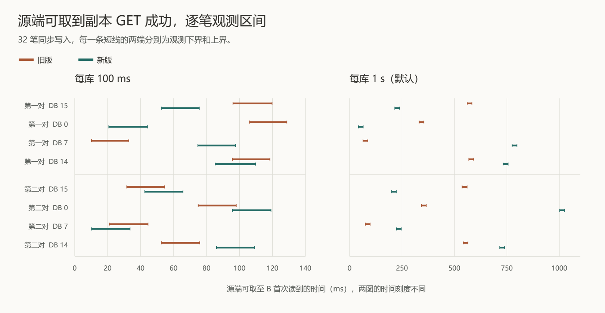

# 16 库副本的空轮询开销与新写入可见延迟

本轮复用上一阶段已经追齐的 16 库夹具，在 WSL ext4 上运行真实 Go 日志源、HTTP/1.1 回环连接和副本 B。实验同时测量每次成功空拉取的分配、正常运行时每秒的分配，以及源端已有新封存段时 B 的持久游标和 GET 何时可见。CLI 默认轮询间隔为 1 秒，另测 100 毫秒。两种间隔都从该库上一次拉取完成时起算。[上一阶段的夹具与实验](replica-recovery-memory.md)

## 为什么改连接池

基线使用 Go 默认 HTTP transport，每个源地址默认只保留 2 条空闲连接。16 个库各自轮询同一源时，请求同时结束会产生更多可复用的连接。基线释放多余连接，下轮需重新建立 TCP 连接和 HTTP 读写缓冲。

先在独立源进程数实际请求及新建连接，在 B 完整读到响应末尾、校验成功且读视图无变化后计数。16 个库各完成 3 次预热，在窗口边界等待所有库停在两次拉取之间。分配分子为 B 进程 `TotalAlloc` 的差，分母为这段时间 B 实际成功完成的空拉取数。源端总请求数须等于这个分母加上 48 次预热。源端新连接数从进程启动算起，包含预热。

| 每库间隔与配对 | 完成请求数 / 版本 | 旧版分配，B/次 | 新版分配，B/次 | 减少 | 源端新建 TCP 连接，旧 → 新 |
| --- | ---: | ---: | ---: | ---: | ---: |
| 100 ms，旧版先跑 | 2,384 | 18,417 | 10,596 | 42.5% | 1,665 → 16 |
| 100 ms，新版先跑 | 2,384 | 17,782 | 10,615 | 40.3% | 1,532 → 16 |
| 1 s，旧版先跑 | 240 | 18,701 | 10,718 | 42.7% | 204 → 16 |
| 1 s，新版先跑 | 240 | 19,445 | 10,726 | 44.8% | 220 → 16 |

另开独立进程采集分配调用栈，采样率为 1 KiB。仅剖析进程在采样边界执行两次 GC，取前后 `alloc_space` 差并过滤写 profile 自身的调用栈。100 ms 基线中的 `net/http.(*Transport).dialConn` 累计分配估算为 19,555,149 字节，约占该窗采样工作负载的 43%；1 s 基线中为 1,904,066 字节。两个新版剖析窗口都没有采到该调用栈。与之相邻的另一个热点是副本每次处理响应都建立的 `bufio.Reader`，新版仍约 4.2 KB/次。采样量用于定位分配调用栈，上表的每请求字节数取自独立精确计量窗口。

新版为每个 follower 克隆标准 `*http.Transport` 的导出配置。在每主机空闲上限使用零值时，按已配置库数提高可保留的空闲连接上限，至少为 Go 默认的 2 条。transport 的总空闲上限、显式的每主机上限、代理、连接与空闲超时及禁用长连接等配置继续生效。关闭一个副本会关闭它自己的空闲池。复用的连接由实际请求按需建立。

## 普通二进制上的开销和代价

每个间隔单独做旧、新、新、旧四个窗口。每窗先用带内存采样的 B 保持约 15 秒无业务流量，仅在首尾发送信号读取 `MemStats`，没有主动 GC，八个窗口均未发生自然 GC。随后用同一数据目录重启不带诊断的 B，做真实同步 RESP 写入。各窗主库、源侧车与 Rust 动态库相同。

| 每库轮询间隔 | 旧版 B 空闲分配，MiB/s | 新版 B 空闲分配，MiB/s | 旧版 CPU，ms/s | 新版 CPU，ms/s |
| --- | ---: | ---: | ---: | ---: |
| 100 ms | 2.658 / 2.615 | 1.592 / 1.592 | 60 / 68 | 24 / 20 |
| 1 s（默认） | 0.291 / 0.263 | 0.167 / 0.163 | 5.33 / 6.67 | 2.67 / 2.00 |

代价可以从 Linux 文件描述符直接看到。旧版各窗口边界均有 2 条连向源的 ESTABLISHED 连接，B 共有 11 个 FD。新版各窗结束时均为 16 条连接、25 个 FD。一窗的开始时为 11 条、20 个 FD。CPU 取进程 tick 差，频率为 100 Hz，小数较多的值来自短窗口换算。本轮的收益指标是空轮询分配，常驻内存与不同部署的 FD 预算可在机器记录中分别核对。

## 对真实新写入的影响

每窗分别向 DB 15、0、7、14 写入标记。先观察封存文件，再用一次真实的源端拉取核对文件名、序号和载荷，独立观察 B 的 `CURRENT` 和 GET。两次观测间隔约 10 ms。源可取时刻夹在最后一次文件不存在的检查开始与首次正确源响应结束之间。源可取到 B 的可见时间据此报告上下界。

| 每库间隔 | B 端观测 | 旧版上界中位数 / 最大值（ms） | 新版上界中位数 / 最大值（ms） |
| --- | --- | ---: | ---: |
| 100 ms | 持久游标 | 86.51 / 118.90 | 86.26 / 118.64 |
| 100 ms | GET | 86.93 / 128.73 | 86.61 / 119.07 |
| 1 s | 持久游标 | 457.17 / 591.44 | 492.41 / 1,023.91 |
| 1 s | GET | 462.84 / 591.90 | 492.82 / 1,024.63 |

八窗共 32 次写入全部发布，在 B 端校验了序号、值以及各库的最终状态。表中每格有 8 个样本。默认间隔的新版 DB 0 发生一次 **1,001.39–1,024.63 ms** 的 GET 延迟。普通窗口按实验时钟安排 SET，并未控制封存时刻与该库上一次拉取之间的距离。为判断这是等待新一轮还是发布变慢，另外做了以实际拉取为起点的复验。

### 封存时刻对齐后的复验

在两个版本的诊断副本中，用同一单调时钟记录上一次空拉取结束、下一次发起请求、清单校验成功、`CURRENT` 目录同步完成以及读视图发布。主库走 gnet，经 RESP 写入标记，再写另一个大键触发日志段轮转。源响应须包含标记的序号和内容。外部 GET 的最后一次未命中与第一次读到新值还须夹住读视图的发布时间。每个阶段采用旧、新、新、旧顺序，两版使用相同探针，CLI 使用默认 1 s 间隔。

| 目标写入时刻（距该库上次空拉取结束） | 旧版源可取至 GET，上界范围 | 新版源可取至 GET，上界范围 | 新版发起请求至发布读视图，中位数较旧版变化 |
| --- | ---: | ---: | ---: |
| DB 15，+25 ms | 986.49–986.73 ms | 990.36–992.38 ms | +2.88 ms |
| DB 0，+450 ms | 561.99–564.55 ms | 563.04–564.28 ms | +0.34 ms |
| DB 7，+850 ms | 159.79–162.69 ms | 163.08–165.63 ms | +3.32 ms |
| DB 0，额外复验 +5 ms | 1,011.47–1,013.77 ms | 1,007.78–1,010.38 ms | +1.16 ms |

表内每个范围取同一版本两个窗口的 GET 上界。先跑前三组，共 12 个标记，再单独对普通窗口出现最长延迟的 DB 0 做第四组，共 4 个标记。纳入的 16 个标记全部在源可取后的第一次拉取完成清单校验、持久化及发布，各窗退出时探针丢弃事件数均为 0。

前三组源可取时间的测量区间宽为 1.73–4.22 ms，各组实际封存相位中点极差最大 6.86 ms。第四组实际可取中点落在上次空拉取结束后 8.93–13.51 ms，两版下一次请求都在上次结束后 1,000.15–1,001.50 ms 发起。旧版的两笔 GET 延迟下界也超过了 1 秒。一次旧版尝试的源可取时间区间宽达 23.65 ms，超出事先规定的 15 ms，原记录与重跑均已保留。各组沿用同一 20 ms 相位匹配容差。

普通窗那笔 1,024.63 ms 上界保留在结果中。定相位测量解释了两版共同具有的等待时间，也显示请求之后仍需十几毫秒安装数据。普通二进制没有逐阶段时钟，不能把那一笔再精确拆分。每组每版两次观测，尚不足以估计 p99 或确认几毫秒的差异能否稳定重现。

## 验收与下一项实验

接纳副本连接池调整，沿用默认 1 s 间隔。依据是四组计数对齐的测量均降低每次空拉取分配，普通进程每秒分配也下降，定相位新写入在首个可取轮次完成发布。适用范围为本机 WSL ext4、单一 HTTP/1.1 回环源和 16 个已追齐的逻辑库。部署时要为同时保留的源连接留出 FD。

- 完整竞态回归通过。Rust 97 项通过，Go 204 个顶层测试及 102 个子测试通过。另有一个专供父测试触发的崩溃子进程入口，在普通枚举时跳过。两个新增的连接池测试另在竞态检测下重复通过 8 次。
- 在 gnet 真实一主两从进程上分别组合旧源与新版副本、新源与旧版副本。两种组合均通过初次追齐、一从离线时另一从继续增量、快照与历史回收、离线从用快照加后缀补齐，以及主库重启。
- 剩余最大的已定位分配是副本在 `pullOnce` 中为每个响应创建读取缓冲区，约 4.2 KB/次。下一项实验单独比较缓冲区复用，覆盖截断响应、重试、并发关闭与恢复后的首次真实发布。

## 复现

在 Linux 的 ext4 检出仓库，使用 Bash、Go、Rust 和 Python 3.12 以上版本。以下命令新建隔离目录，重新生成一个已追齐的 16 库夹具。两版使用同一夹具、源、主库和 Rust 动态库。正式测量复用了前轮冻结的二进制与夹具，完整 SHA-256 在机器记录中。[逐窗机器记录](replica-idle-polling.json) · [分配诊断及探针说明](../../scripts/diagnostics/golog_idle_polling/README.md)

~~~bash
set -euo pipefail
repo="$PWD"
run=$(mktemp -d "$HOME/kerniva-poll-review.XXXXXX")
mkdir "$run/old-src" "$run/seed" "$run/ordinary" "$run/phase" "$run/db0"
git archive 93787a2 | tar -x -C "$run/old-src"
(cd "$run/old-src" && go build -trimpath -o "$run/old-B" ./cmd/kerniva-replica)
mkdir "$run/new-src"
git archive 3905fc4 | tar -x -C "$run/new-src"
(cd "$run/new-src" && bash scripts/build.sh)
bin="$run/new-src/bin"
seed=(python3 -B scripts/golog_replica_snapshot_capacity.py --root "$run/seed" --bin "$bin")
"${seed[@]}" --prepare
"${seed[@]}" --limit 0 --name seed
origin="$run/seed/seed-1-cap0"

profile=(python3 -B scripts/diagnostics/golog_idle_polling/run.py
         --repo "$repo" --origin "$origin" --library "$bin/libkerniva_engine.so")
"${profile[@]}" --revision 93787a2 --root "$run/count-A"
"${profile[@]}" --revision 3905fc4 --root "$run/count-B" --source-binary "$run/count-A/idle-diagnostic"
for entry in B:3905fc4 A:93787a2; do
  "${profile[@]}" --revision "${entry#*:}" --root "$run/reverse-${entry%%:*}" \
    --source-binary "$run/count-A/idle-diagnostic" --window 1s exact --window 100ms exact
done
python3 -B scripts/golog_replica_poll_ordinary.py --root "$run/ordinary" \
  --origin "$origin" --bin "$bin" --source-binary "$bin/kerniva-replica" \
  --baseline "$run/old-B" --candidate "$bin/kerniva-replica"

for entry in A:93787a2 B:3905fc4; do
  python3 -B scripts/diagnostics/golog_idle_polling/build_phase.py --repo "$repo" \
    --revision "${entry#*:}" --root "$run/diag-${entry%%:*}"
done
phase=(python3 -B scripts/golog_replica_poll_phase.py --origin "$origin" --bin "$bin"
       --baseline "$run/diag-A/bin/kerniva-replica" --candidate "$run/diag-B/bin/kerniva-replica")
"${phase[@]}" --root "$run/phase"
"${phase[@]}" --root "$run/db0" --phase 0 5
(cd "$run/new-src" && bash scripts/test.sh -race)
~~~

普通写入脚本保存外部观测的时间界、版本哈希和逐库终态。定相位脚本同时保留被排除的尝试及理由，单窗的 `b-phase.jsonl` 可与 `result.json` 的单调时钟对齐。[普通窗口脚本](../../scripts/golog_replica_poll_ordinary.py) · [定相位脚本](../../scripts/golog_replica_poll_phase.py)
