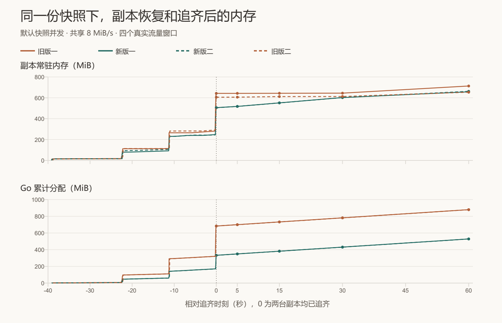

# 副本快照恢复的内存归因与复验

本次测量以一主两从中的落后副本 B 为对象。B 的 15 个逻辑库分别补齐约 8、16 或 32 MiB 的快照，每档五份，另一个轻库在慢传输中接受三次更新。每个正常窗口复用同一份 280.4 MiB 快照、相同的初始游标、主库和 Rust 动态库，按每库 100 ms 的实验间隔轮询。A 直连源，B 独享载荷上限为 8 MiB/s 的中继。每轮实际传输 294,025,013 字节，所有 Linux 内存数字按 MiB 计算。

## 分配发生在哪个阶段

在同一个基线二进制上分别开启和关闭诊断。按表中顺序重复，两种并发上限各有一对正序与一对反序。并发上限 0 允许所有慢库同时恢复，4 表示最多四个快照安装进行中。三笔轻库标记分别在慢快照传输达到约 10%、45%、75% 时写入、封存，并从 B 查询。

| 顺序 | B 上限 | 阶段诊断 | 追齐（秒） | 追齐前峰值 RSS | 追齐时 RSS | 追齐后 60 秒 RSS | 追齐前 B CPU（秒） |
| ---: | ---: | --- | ---: | ---: | ---: | ---: | ---: |
| 1 | 0 | 关 | 38.908 | 585.73 | 582.15 | 623.75 | 3.66 |
| 2 | 4 | 关 | 38.527 | 516.13 | 516.13 | 614.28 | 3.80 |
| 3 | 0 | 开 | 39.049 | 619.43 | 619.43 | 678.90 | 3.85 |
| 4 | 4 | 开 | 38.683 | 584.06 | 584.06 | 652.13 | 4.53 |
| 5 | 4 | 开 | 38.637 | 605.03 | 605.03 | 661.50 | 4.87 |
| 6 | 0 | 开 | 38.975 | 630.90 | 623.98 | 692.06 | 3.70 |
| 7 | 4 | 关 | 38.671 | 585.41 | 577.63 | 628.86 | 4.17 |
| 8 | 0 | 关 | 38.847 | 585.75 | 572.93 | 703.75 | 4.20 |

启用诊断后，同半组、同上限配对的追齐时差为 −0.034 至 +0.156 秒，记录的峰值 RSS 高 19.62–67.94 MiB。两组都读取 Linux 进程计数器和 `smaps_rollup`。诊断组还记录 Go 堆、GC 次数与恢复阶段，因此绝对 RSS 另用关闭阶段诊断的窗口复核。峰值取启动至追齐的 `VmHWM`，追齐及其后各点取当时的常驻页。

Rust 打开恢复句柄时会校验快照并构建原生状态。随后 Go 遍历恢复行、解码键值、建立可供查询的读视图。在四个诊断窗口，将「至少一个库正在导出行」的时间取并集，每段进程级 `TotalAlloc` 差值只计算一次。逐行导出期间分别分配 **633.78、634.14、634.69、633.80 MiB**，占首个快照开始安装至最后一个新视图切换期间的 **89.8%–93.0%**。这给出了追查顺序。逐库的重叠时段无法单独解释 Linux RSS，也无法直接量出 Rust 分配器的占用。

## 追齐后，内存去了哪里

两台副本继续正常轮询，停止业务写入，在追齐时及 5、15、30、60 秒观察进程，全程使用 Go 自然 GC。基线的四个关闭诊断窗口中，60 秒时 B 的 RSS 为 **614.28–703.75 MiB**。四个诊断窗口在这 60 秒里又累计分配约 **196–203 MiB**，没有新载荷或待完成的快照。一个窗口在头 5 秒经历 GC，Go 当前堆从 386.5 降至 284.4 MiB，同期 RSS 从 619.4 变为 620.1 MiB。一次回收后的堆大小和操作系统报告的驻留页可以相差很大。

另用两次独立进程打开同一套已发布数据，保留读视图，不启动轮询。在这个专用诊断程序中主动回收后，Go 堆分别为 281.80 和 281.81 MiB。再请求 Go 归还可释放的页，进程 RSS 由 515.17 降至 432.00 MiB、503.11 降至 419.26 MiB。两次均在最后读回 16 个库。剩余常驻页包含 Go 堆及其他运行时、原生和映射页，本次没有逐项拆分。该专用程序与线上恢复窗口独立。[静置诊断程序](../../scripts/diagnostics/replica_view_linux.go)

## 只改副本的全量恢复

旧版把 Rust 交出的每行键和值复制到 Go 临时缓冲，再由反序列化创建最终值。新版允许副本在同步回调内直接解码原生行，回调返回时释放行缓冲。存入读视图的键、值、集合元素和历史编码均拥有自己的存储。主库继续使用可持有副本的旧 API，副本增量重放沿用分块接口。中断处理和 `CURRENT` 的持久化顺序保持原有语义。

先断开来源，把同一个已追齐的 B 目录复制到四个独立位置。每个新进程按库顺序恢复，原生打开与 Go 逐行恢复的分配差可以分开读出。

| 离线重开顺序 | 原生打开期间 Go 分配 | 逐行恢复期间 Go 分配 | 就绪时峰值 RSS | 启动至首次就绪 |
| --- | ---: | ---: | ---: | ---: |
| 旧版一 | 0.061 MiB | 633.29 MiB | 551.62 MiB | 960 ms |
| 新版一 | 0.062 MiB | 283.08 MiB | 366.79 MiB | 808 ms |
| 新版二 | 0.062 MiB | 283.07 MiB | 408.97 MiB | 816 ms |
| 旧版二 | 0.061 MiB | 633.28 MiB | 520.02 MiB | 1,010 ms |

四次均在来源不可用时核对 16 个库的 `CURRENT`、来源与序号，重启后安装次数为零。每个慢库还核对快照 SHA-256，读取首、中、末批量键、更新值和尾段值，查询被删键得到 404。此处 RSS 为离线串行加载期间的高水位；下一组才包含真实下载与多库并行。

## 真实传输的前后对照

两套程序的四个窗口均按旧、新、新、旧运行，使用默认并发上限 0，仅替换副本 B。下表给出同一对中旧版与新版的数值，第二对的实际运行顺序为新版在先。

| 模式与配对 | 旧版 → 新版追齐前峰值 RSS | 峰值下降 | 旧版 → 新版追齐时间 | 旧版 → 新版追齐后 60 秒 RSS |
| --- | ---: | ---: | ---: | ---: |
| 普通，一 | 615.29 → 497.21 MiB | 19.19% | 38.769 → 38.728 s | 窗口止于追齐 |
| 普通，二 | 643.19 → 486.78 MiB | 24.32% | 39.056 → 38.918 s | 窗口止于追齐 |
| 阶段诊断，一 | 642.69 → 508.70 MiB | 20.85% | 39.132 → 38.952 s | 713.13 → 657.70 MiB |
| 阶段诊断，二 | 635.20 → 523.04 MiB | 17.66% | 38.816 → 39.161 s | 653.51 → 662.21 MiB |

在有诊断的两对中，启动至追齐的 B 进程 Go 总分配分别由 **683.38 降至 332.93 MiB**、**683.00 降至 332.61 MiB**。两对均少分配约 350.4 MiB，其中行导出时段从约 634.1 MiB 降至 283.5–283.6 MiB。常规窗口也复现了 118.07 和 156.41 MiB 的实际峰值降幅，因此采纳这项改动。8 MiB/s 链路下的追齐时间仍约为 39 秒。追齐后 60 秒的 RSS 一对下降 55.43 MiB、另一对上升 8.70 MiB，长期驻留仍须另行测量。

图中虚线与实线表示两次反序配对。负时间为下载和恢复阶段，零点为首次观测到 A 与 B 都追齐。零点右侧的圆点是五次实测，连线仅用于对照。上图左侧是进程 RSS 采样。表中的 `VmHWM` 还包含采样间隙出现的峰值。

## 数据正确性与边界

- 八个正常前后对照窗口共写入 24 个轻库标记，B 的 `CURRENT` 和 GET 都在慢库传输结束前观测到新值。关闭诊断的新版两窗共六笔；源可取至 B 读到的观测上界最大 **205.86 ms**，至持久游标的上界最大 **205.92 ms**。开启诊断的新版最大 GET 上界为 206.31 ms。各探针并非连续观测，明细保存了最后阴性和首次阳性的时间。这些样本量适合核对慢库与轻库是否互相阻塞。
- 在上限 4 的单独故障窗中，DB 1 的快照传到 **524,288 字节**时中断。B 记录 `unexpected EOF`，仍从序号 2 读到旧值。重试完整取得 **8,400,792 字节**，清理失败暂存代，发布序号 **261**。断开源端后，同一二进制在原 B 目录重启，16 个库游标和抽读结果都正确，前后两个 B 进程都以状态 0 退出。该窗验证限流时的正确性，性能对照测的是上限 0。
- Rust 全部 97 项测试通过。WSL ext4 下的 Go `-race` 回归通过 202 项顶层测试及 97 项子测试，其中包括借用的取消与 panic、七类 V3 数据在输入缓冲覆写后的持有行为、历史 Gob 编码与离线读取。单独启动会跳过的故障子进程由对应的崩溃恢复主测试驱动。全量测试重建的副本程序与正式候选二进制逐字节相同。
- 本次夹具在恢复前的旧视图只含少量种子键。已有大视图在线被替换、跨机器长时运行、不同链路与不同负载的常驻内存，需要各自的实验。

## 已追齐副本的空轮询

另取已经追齐的 B 目录与对应主库目录，启动源与 B 直连。固定新版 B 和 16 个库，只改变每库轮询间隔。1 秒也是命令行 follow 的默认值。各窗确认就绪后先暖身一秒，再记录约 15 秒内的累计分配。期间没有业务流量，Go 进行自然回收。

| 轮询间隔（运行顺序） | 100 ms | 1 s | 1 s | 100 ms |
| --- | ---: | ---: | ---: | ---: |
| B 的 Go 分配速率（MiB/s） | 2.925 | 0.297 | 0.301 | 2.816 |
| 15 秒内 B 用掉的 CPU 时间（秒） | 0.54 | 0.08 | 0.05 | 0.69 |

两次 1 秒窗口的分配速率均比配对的 100 毫秒窗口低约九成。16 个库前后的游标、已发布数据与读值一致，向源发起的逐库见证请求都返回成功且没有文件载荷。四窗 GC 次数均保持 7。使用仓库脚本从同一起点再跑四窗，分配速率依次为 2.844、0.298、0.299 和 2.823 MiB/s。实验没有统计 B 实际发送的 HTTP 请求次数，也没有注入新写入。这支持下一步剖析空轮询的分配调用栈，并在保持相同间隔时测优化收益和新值可见延迟。[直连轮询实验脚本](../../scripts/golog_replica_idle_polling.py)

## 复现

在 Linux ext4 检出本仓库，需要 Go、Rust 和 Python 3。从同一次构建保留主库、动态库和维护进程，再从基线提交构建旧版副本。每轮程序自行分配本机端口；对照期间让同一台机器串行运行各窗口。

~~~bash
set -eu
repo="$PWD"
run=$(mktemp -d "$HOME/kerniva-recovery-memory.XXXXXX")
mkdir -p "$run/old-src" "$run/windows"
bash scripts/build.sh
git archive b110c1a | tar -x -C "$run/old-src"
(cd "$run/old-src" && go build -trimpath -o "$run/old-B" ./cmd/kerniva-replica)
go build -trimpath -o "$run/new-B" ./cmd/kerniva-replica

bench=(python3 -B scripts/golog_replica_snapshot_capacity.py
       --root "$run/windows" --bin "$repo/bin" --replica "$run/old-B")
"${bench[@]}" --prepare
"${bench[@]}" --memory --name calibrated
"${bench[@]}" --compare-follower "$run/new-B" --name compared-trace

for label in 1-old 2-new 3-new 4-old; do
  "${bench[@]}" --limit 0 --follower "$run/${label#*-}-B" --name "ordinary-$label"
done
"${bench[@]}" --follower "$run/new-B" --limit 4 --fault --name interrupted

for label in 1-old 2-new 3-new 4-old; do
  python3 -B scripts/golog_replica_memory_reopen.py \
    --replica "$run/${label#*-}-B" --lib "$repo/bin/libkerniva_engine.so" \
    --fixture "$run/windows/fixture" --state "$run/windows/compared-trace-1-cap0-baseline/b" \
    --output "$run/reopen-$label"
done
(cd "$run/old-src" && mkdir -p .memory-probe &&
 cp "$repo/scripts/diagnostics/replica_view_linux.go" .memory-probe/main.go &&
 KERNIVA_ENGINE_LIBRARY="$repo/bin/libkerniva_engine.so" go run ./.memory-probe "$run/reopen-1-old/local")
mkdir "$run/idle-polling"
python3 -B scripts/golog_replica_idle_polling.py --root "$run/idle-polling" \
  --origin "$run/windows/ordinary-2-new-1-cap0" --bin "$repo/bin" --source-binary "$run/old-B" --follower "$run/new-B"
bash scripts/test.sh -race
~~~

复现会重新生成来源标识及夹具。正式对照复用上一轮冻结的同一夹具、主库、维护进程和 Rust 库，每组内仅替换 B。机器记录保存工件 SHA-256、逐窗高水位和标记观测上界；每次运行目录还会产生包含完整采样、传输见证、序号、摘要的 `result.json`，诊断组另有 `b-memory.jsonl`。[逐窗机器记录](replica-recovery-memory.json) · [网络实验脚本](../../scripts/golog_replica_snapshot_capacity.py) · [断源重启脚本](../../scripts/golog_replica_memory_reopen.py)
