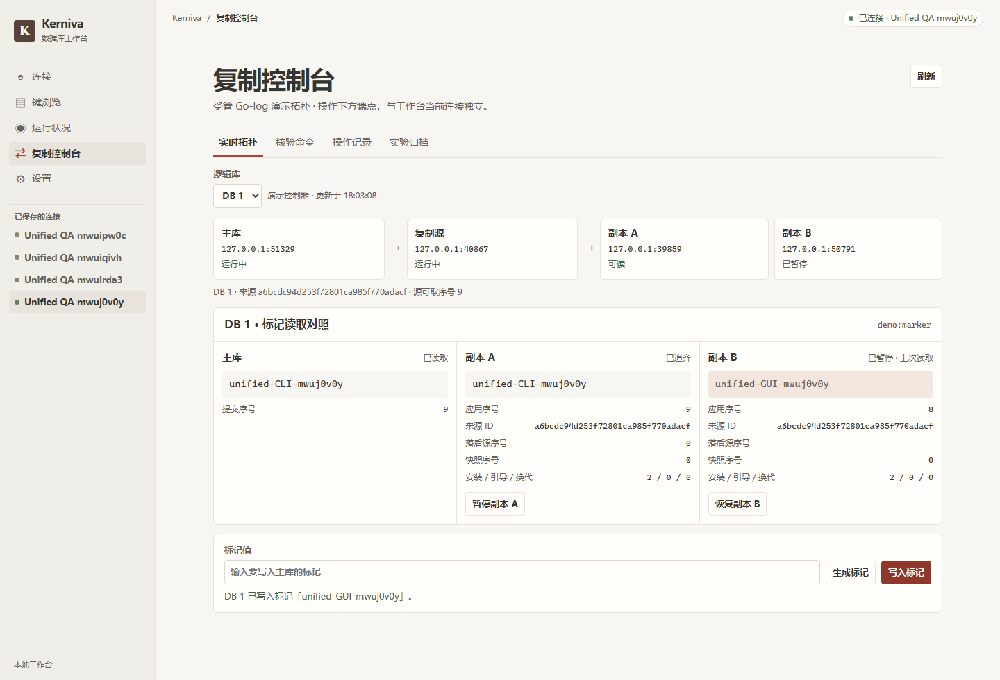

# 统一工作台验收

2026-11-24 在 Windows 原生 Python、Microsoft Edge 和 WSL2 Linux 上完成。图形界面、交互终端和受管复制使用同一份业务接口。测试使用独立的临时配置、数据库目录和端口。

| 检查 | 实测结果 |
| --- | --- |
| 图形界面与终端互通 | 在网页往 DB 1 写入标记，终端能从真实主库读到。终端暂停 B，再写入新标记，网页显示主库和 A 已更新，B 显示已标注的上次读取。网页恢复 B 后，A、B 均在同一来源追至序号 9，DB 0 维持序号 1。 |
| 活动记录和归档 | 单命令集成验收核对了来自两个入口的 6 条成功操作，分页为 5 和 1。归档含 16 条带原始数据 SHA-256 的实验记录。浏览器检验覆盖翻页、展开、重载和 390 像素宽屏幕。 |
| 故障与退出 | 停止隔离的复制实例后，统一工作台收到 HTTP 503，显示状态过期并禁用写入、暂停和恢复。普通连接页仍可使用。Linux 托管及 Windows 原生工作台托管 WSL 两种方式都验证了退出后四个数据库服务监听关闭。 |
| 普通 Redis 与集群监控 | Redis 8.0.5 单机 DB 2 有 5 个键，三主集群的三个主节点分别有 3、4、5 个键。与每个节点的 `redis-cli DBSIZE` 一致。禁止 `INFO` 的账号、错误密码和 TLS 校验失败均返回节点错误。 |
| 命令行 | Windows 和 WSL 均通过 6 项终端测试，覆盖连接选择、认证失败保留原连接、空键和二进制键、前后翻页及共享设置。两端均验证了正式启动命令。 |

## 从干净的源码检出复验

在配置好本项目 Go、Rust 和 Python 工具链的 WSL 或 Linux 仓库根目录运行。完整测试脚本会构建受管复制需要的服务和动态库。

~~~sh
bash scripts/test.sh
python3 -B -m unittest discover -s scripts -p test_workbench_shell.py -v
python3 -B scripts/test_workbench_integration.py
~~~

在 Windows 上复验原生工作台管理 WSL 的生命周期，可向集成测试传入已构建的 Linux 二进制目录。替换发行版及路径为本机值。

~~~powershell
python -B scripts/test_workbench_integration.py --wsl-distro <发行版> --bin-dir /absolute/path/to/Kerniva/bin
~~~

要在相同的临时实例上复验图形界面和终端互通，安装 Node.js 22 或更新版本，并通过 `--browser` 指定本机 Edge 或 Chromium 可执行文件。例如在 Windows PowerShell 中运行以下命令，替换 WSL 发行版、二进制目录和浏览器路径。

~~~powershell
python -B scripts/test_workbench_integration.py --wsl-distro <发行版> --bin-dir /absolute/path/to/Kerniva/bin --browser "C:\Program Files (x86)\Microsoft\Edge\Application\msedge.exe"
~~~

集成测试只操作自己创建的实例。通过时输出 `ok`、逻辑库与副本数量、活动页数、实验数量和 `cleanShutdown`。带浏览器的测试还会打开已保存的连接、查看运行状况、在同一窗口确认两个副本都读到终端写入的值，然后从网页暂停 B、从终端恢复。对应的 `singlePage`、`bothReplicas`、`uiPause`、`cliResume` 均应为 `true`。上表中的窄屏和控制器断线结果来自另外一轮 Edge 验收。[集成测试](../../scripts/test_workbench_integration.py) · [浏览器检查](../../scripts/test_workbench_browser.mjs) · [交互终端测试](../../scripts/test_workbench_shell.py) · [使用说明](../database_workbench.md)
